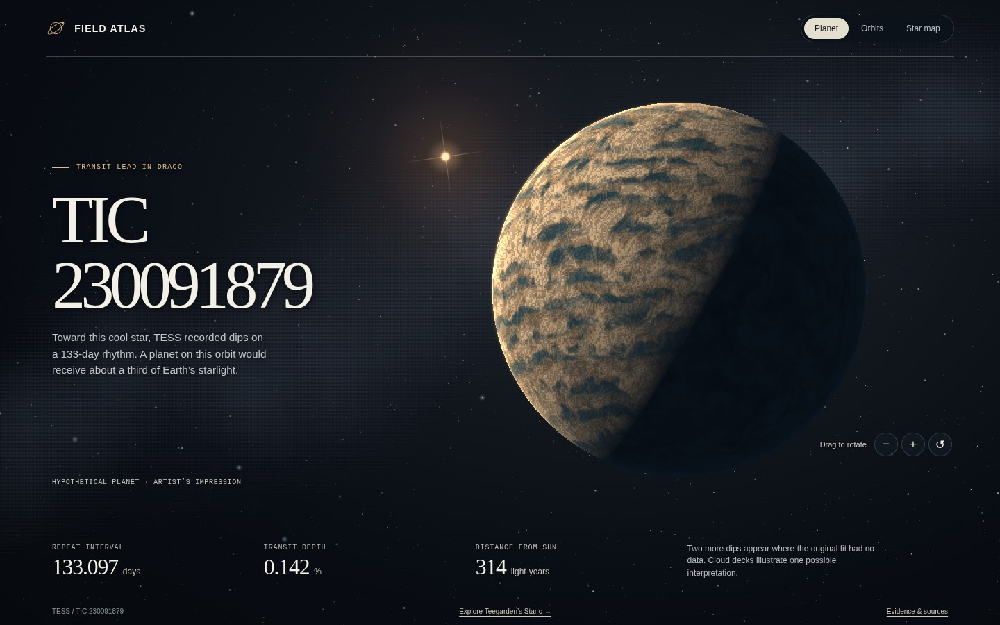

# Space

## TIC 230091879 and Teegarden’s Star c

Two predicted dimmings around **TIC 230091879** appear in TESS full-frame photometry at times missing from the original pipeline fit. The measurements strengthen a 133-day transit-like signal. Its source and planetary nature remain open.

A separate blind search of CARMENES stellar velocities recovered **Teegarden’s Star c**, a known planet with a minimum mass close to Earth’s in a temperate orbit.

[Interactive 3D atlas](field-atlas/index.html) · [TESS evidence and reproduction](tess-search/README.md) · [CARMENES evidence and reproduction](carmenes-search/README.md)

Download and open `field-atlas/index.html` in a browser to explore both systems offline. Drag or use the arrow keys to rotate. Use the planet, orbit and star-map controls to change scale. The link at the bottom switches targets.

## Earlier investigation

[RK-1 single-transit candidate and report](rk-1/README.md)
