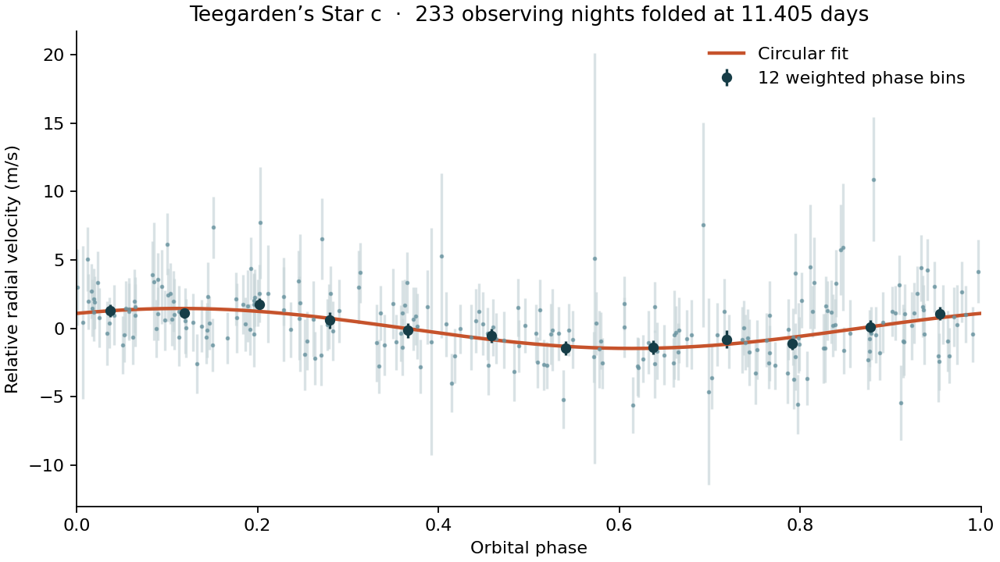

# Blind recovery of Teegarden’s Star c

A search of public CARMENES radial velocities found a signal at **11.4047 days** in 233 observing nights spanning 1,383 days. We committed the full detection list before consulting planet catalogs. The signal matches **Teegarden’s Star c**, reported by Zechmeister and colleagues in 2019. This is a recovery from archival observations. [Blind peak list](results/blind-peaks.csv) · [Original discovery](https://doi.org/10.1051/0004-6361/201935460) · [NASA system record](https://exoplanetarchive.ipac.caltech.edu/overview/teegarden)

| Quantity | This circular fit |
|---|---:|
| Period | 11.4047 days |
| Stellar velocity semiamplitude | 1.46 m/s |
| Planet minimum mass | 1.09 Earth masses |
| Orbital radius | 0.0456 AU |
| Incident starlight | 0.53 times Earth’s |

The star is about 12.49 light-years away in Aries. This planet’s low minimum mass and irradiation place it among nearby targets where surface water is physically plausible for a suitable atmosphere. The one-Earth-mass model gives a conservative habitable zone of 0.034–0.068 AU for the adopted star. Radial velocities leave the planet’s true mass, radius, atmosphere and surface conditions unresolved. [Climate model](https://doi.org/10.1088/2041-8205/787/2/L29) · [Multi-instrument system analysis](https://doi.org/10.1051/0004-6361/202348033)



## Search design

The input snapshot contains 18,642 spectra rows and 361 stellar entries from the 2016–2020 data release. We used survey targets with matching stellar metadata, no multiplicity remark, at least 40 clean observing nights and a baseline of at least 180 days. The search covered 135 stars. We binned by integer BJD with inverse-variance weights after removing flagged spectra, unusable uncertainties and gross outliers. A 1.5 m/s noise floor was added to the nightly uncertainties. [DR1 release](https://doi.org/10.1051/0004-6361/202244879) · [GAVO data service](https://dc.g-vo.org/browse/carmenes/t) · [Search ledger](results/search-ledger.csv)

A weighted Lomb–Scargle search ran from two days to the shorter of 200 days and one third of each baseline. We fitted a linear trend, successively removed up to four sinusoids and refined their frequencies and amplitudes together. We retained 103 peaks passing a per-stage nominal false-alarm threshold of 0.01. Prewhitening can create aliases. Stellar activity, correlated noise and searching many stars limit the interpretation of these screening values.

The exploratory shortlist selected 15 signals on 13 hosts with nominal flux between 0.2 and 1.6 times Earth’s and minimum mass below 10 Earth masses. Five periods matched archive planets within 1.5% in the positional cones. For example, the strong 43.54-day Ross 318 signal also appears in the star’s hydrogen-alpha index, a tracer of magnetic activity. The 39.33-day signal at HD 216899 is close to its 39.5-day stellar rotation and appears in the line-width indicator. We retained the unmatched peaks for inspection without promoting them to planets. [Vetting table](results/temperate-vetting.csv) · [Ross 318 activity study](https://doi.org/10.1051/0004-6361/201936102)

The SERVAL velocity **numbers** used here are m/s. GAVO labels the corrected columns km/s. The first matched Teegarden row has a velocity of −3.202068 and uncertainty 1.820852 in both the TAP extract and the instrument team’s AVC/E_AVC file. The team identifies AVC in m/s. The RACOON columns use different units and were excluded from the velocity fit. [Instrument team’s release and plot labels](https://carmenes.cab.inta-csic.es/gto/jsp/dr1Public.jsp) · [GAVO column definitions](https://dc.g-vo.org/tableinfo/carmenes.rvs)

## How well does the signal repeat?

No tested activity indicator for this star showed strong modulation at 11.405 days. The fixed-frequency nominal p-values were 0.31 for hydrogen-alpha, 0.35 for line width and 0.41 for line bisectors. The velocity fit included a separate 4.909-day signal matching planet b and a 172.9-day nuisance term. We assign no planetary interpretation to the latter.

We carried the DR1 frequency and phase into published data from HPF, ESPRESSO and the red arm of MAROON-X. The check retained 103 instrument-nights, fitting offsets for each instrument or observing run and a nuisance sinusoid at b’s DR1 period. A free amplitude gave 0.51 times the DR1 prediction, with nominal p = 0.024 under the stated noise assumptions. Fixing the amplitude as well improved χ² by only 0.35. The external data offer modest support for the phase and weak leverage on the exact DR1 amplitude. The system’s published classification comes from the original and subsequent multi-instrument studies. [Test result](results/independent-test.csv) · [Follow-up data](https://doi.org/10.26093/cds/vizier.36840117)

## Reproduction

From the repository root, the following commands use the bundled compressed tables. `fetch.py` and `fetch_followup.py` can refresh the discovery and post-search inputs respectively. Updated live catalogs can differ from the included snapshot.

```sh
python -m pip install -r requirements.txt
python carmenes-search/survey.py
python carmenes-search/validate.py
```

This analysis uses the CARMENES consortium’s observations from Calar Alto, the GAVO service, the NASA Exoplanet Archive and CDS VizieR. The scripts and atlas were developed with OpenAI Codex.
