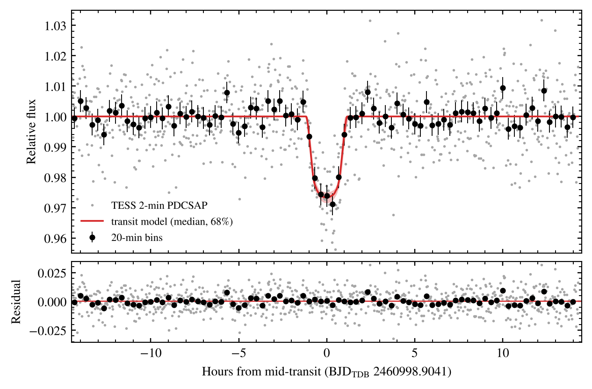
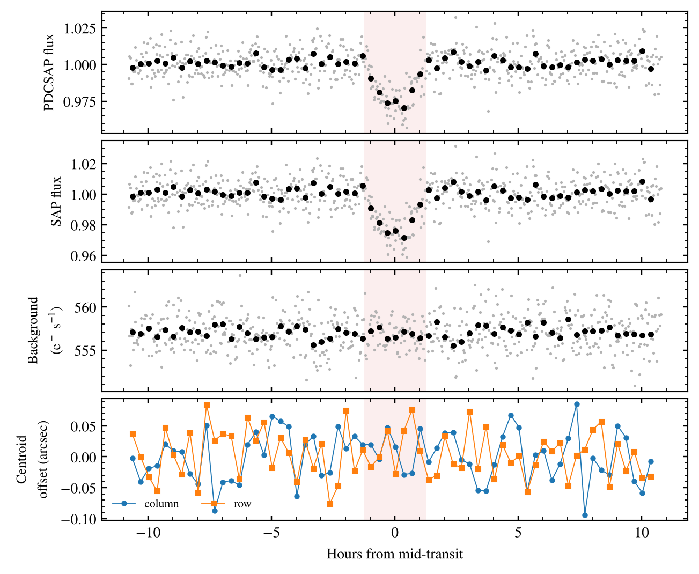
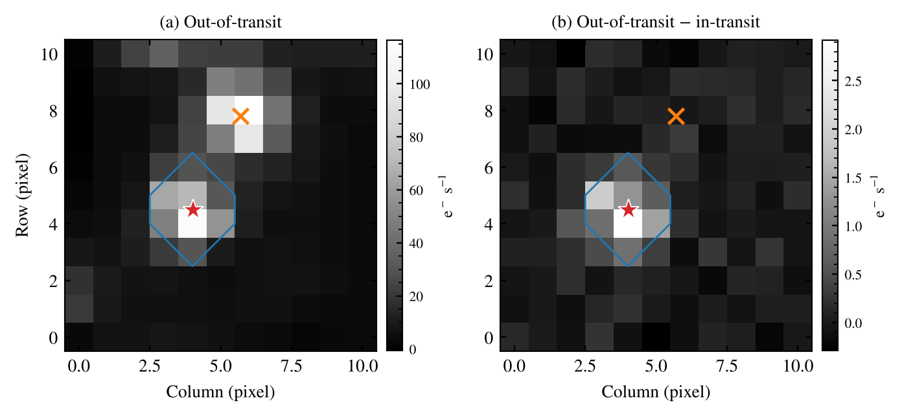
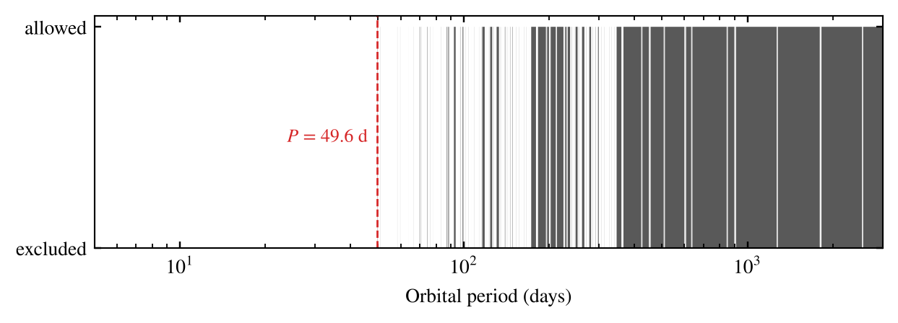

[Download the original PDF](https://raw.githubusercontent.com/RajveerKapoor/space/main/rk-1/paper/TIC178994149_paper.pdf)

Draft version November 24, 2026 · Not peer reviewed

# TIC 178994149.01: A Single-Transit Giant-Planet Candidate Orbiting a Nearby M Dwarf Identified in TESS Sector 98

Rajveer Kapoor1

1Independent researcher

## ABSTRACT

We report a single transit-like event on the M dwarf TIC 178994149 (2MASS J04390289−2919401; *d* = 116.1 pc), found in a systematic search of the 153,730 two-minute-cadence light curves obtained by the Transiting Exoplanet Survey Satellite (TESS) in Sectors 97–108. The event, centered at BJDTDB 2460998.9041 ± 0.0020, has a depth of 2.6 ± 0.2% and a duration of 2.5 ± 0.3 h. A limb-darkened transit model gives *R*p/*R*∗ = 0.156+0.010−0.008 for non-grazing solutions, corresponding to *R*p = 8.2+0.5−0.4 *R*⊕ (0.73 *R*J). Pixel-level analysis places the source of the signal on the target, with no accompanying change in background flux or flux-weighted centroid and no comparable event in other stars. Seven TESS sectors spanning 2018–2026 contain no further transit, which requires *P* > 49.6 d. The transit is shorter than expected for a central transit on such an orbit, implying either a substantial eccentricity (*e* ≳ 0.5) or a grazing geometry. The object does not appear in the TOI or Community TOI lists, the NASA Exoplanet Archive, or any SPOC threshold-crossing-event list. If confirmed, it would be a rare temperate giant planet orbiting an M dwarf. We describe the search, the vetting, and the follow-up needed to establish its nature.

*Keywords:* Exoplanets — Transit photometry — Exoplanet detection methods — M dwarf stars — Extrasolar gaseous giant planets

## 1. Introduction

The Transiting Exoplanet Survey Satellite (TESS; Ricker et al. 2015) has produced several thousand planet candidates, the majority identified by the Science Processing Operations Center (SPOC) pipeline (Jenkins et al. 2016) and released through the TESS Object of Interest (TOI) process (Guerrero et al. 2021). The SPOC transit search requires at least two transits within the searched baseline. Planets with orbital periods longer than an observing sector therefore often appear as isolated single events, which have been recovered mainly by visual and citizen-science surveys (e.g., Eisner et al. 2021).

Giant planets orbiting M dwarfs are intrinsically rare, and long-period examples are particularly valuable for testing giant-planet formation around low-mass stars. In this note we report a single transit on the M dwarf TIC 178994149, found in a systematic search of the TESS two-minute light curves from Sectors 97–108 (2025–2026). At the time of writing these sectors had been searched by SPOC only sector by sector; the most recent SPOC multi-sector search ends at Sector 96.

## 2. Data and Search

### 2.1. Photometry and Event Search

We retrieved all 153,730 SPOC two-minute light curves for Sectors 97–108 (84,380 unique stars) from the Mikulski Archive for Space Telescopes (MAST). We used the Presearch Data Conditioning simple-aperture-photometry (PDCSAP) flux, discarded cadences with nonzero quality flags, binned each light curve to 10 minutes, and removed stellar variability with a robust biweight filter of 1-day width (wotan; Hippke et al. 2019). We then searched each light curve for individual box-shaped decrements with durations of 1–13 h, normalizing each trial by the scatter of the box-averaged flux so that correlated noise is accounted for. In parallel, we ran a box least-squares search (Kovács et al. 2002) for periods of 8–120 d on the combined light curves of the 11,496 stars observed in two or more of these sectors.

### 2.2. Candidate Selection

Events with signal-to-noise ratio S/N ≥ 7.5 were cross-matched against the TOI catalog (8,175 entries), the Community TOI (CTOI) list (5,139 entries), the NASA Exoplanet Archive (6,473 planets), and the ephemerides of all 342,199 SPOC threshold-crossing events (TCEs) from single- and multi-sector searches through Sector 108, all retrieved on 2026 November 24. We removed events that coincided in time with events in many other stars, fell within 0.5 d of a data gap, or were associated with reaction-wheel momentum dumps. About 50 remaining candidates were examined individually with the tests of Section 5. Nearly all proved to be eclipsing binaries on neighboring stars, artifacts from background-flux excursions caused by scattered light or passing Solar System objects, or stellar variability. One signal, on TIC 178994149, passed every test.

## 3. The Host Star

TIC 178994149 is a mid-M dwarf at 116.1 ± 0.3 pc (Gaia Collaboration et al. 2023). Its properties are listed in Table 1. The TESS Input Catalog (TIC; Stassun et al. 2019) gives *T*eff = 3320 ± 157 K, *R*∗ = 0.482 ± 0.014 *R*☉, and *M*∗ = 0.48 *M*☉, based on the empirical relations of Mann et al. (2015). The Gaia renormalized unit weight error, RUWE = 1.12, gives no indication of an astrometric companion, and the TIC contamination ratio is 4 × 10−4. The star nevertheless lies about 1.1–1.4 mag above the main sequence in both *G* and *K*s for its color (*G*BP − *G*RP = 2.71; cf. Pecaut & Mamajek 2013). This may indicate youth or an unresolved companion, which we discuss in Section 7.

**Table 1.** Properties of TIC 178994149

| Parameter | Value | Source |
| --- | --- | --- |
| Other identifiers | 2MASS J04390289−2919401; Gaia DR3 4879180296770956416 |  |
| R.A., decl. (J2000) | 04h39m02s.91, −29°19′40″.2 | Gaia DR3 |
| Proper motion | μα\* = +14.3, μδ = −2.8 mas yr−1 | Gaia |
| Parallax | 8.614 ± 0.020 mas | Gaia DR3 |
| Distance | 116.1 ± 0.3 pc | Gaia DR3 |
| *T*, *G*, *V* | 13.58, 14.83, 16.17 mag | TIC, Gaia |
| *J*, *K*s | 11.95, 11.07 mag | 2MASS |
| *G*BP − *G*RP | 2.71 mag | Gaia DR3 |
| *T*eff | 3320 ± 157 K (3439 K) | TIC v8.2 (Gaia GSP-Phot) |
| *R*∗, *M*∗ | 0.482 ± 0.014 *R*☉, 0.48 *M*☉ | TIC v8.2 |
| ρ∗ | 4.28 ρ☉ | TIC v8.2 |
| Radial velocity | 17.5 ± 5.5 km s−1 | Gaia DR3 |
| RUWE | 1.117 | Gaia DR3 |

## 4. The Transit Signal

The event occurs at BTJD 3998.904 (2025 November 19, 09:41 UTC) in Sector 98, during which the star was observed on camera 2, CCD 1, from 2025 November 9 to 2026 January 5. Figure 1 shows the light curve. We fit the PDCSAP flux within ±0.6 d of the event after dividing out a quadratic baseline fit to the out-of-transit data. The model, computed with batman (Kreidberg 2015), assumes a circular orbit and quadratic limb darkening with Gaussian priors *u*1 = 0.20 ± 0.10 and *u*2 = 0.40 ± 0.10, appropriate for a 3300 K dwarf in the TESS band (Claret 2017). The free parameters are the mid-transit time *T*0, the radius ratio *k* = *R*p/*R*∗, the impact parameter *b*, the period *P*, and the stellar density ρ∗. A log-uniform prior on ρ∗ lets the light curve alone constrain the transit shape. We sampled the posterior with emcee (Foreman-Mackey et al. 2013) using 40 walkers for 6000 steps and discarded the first 2500.

The data do not distinguish grazing from non-grazing geometries: 51% of the posterior samples have *b* < 1 − *k*. For those, *k* = 0.156+0.010−0.008 and *R*p = 8.2+0.5−0.4 *R*⊕, slightly smaller than Saturn. Grazing solutions allow larger radii. Table 2 summarizes the results.

**Figure 1.** TESS Sector 98 two-minute PDCSAP photometry of TIC 178994149 around the transit (gray points) and 20-minute bins (black). The red curve and band show the median and 68% interval of transit models drawn from non-grazing posterior samples. The lower panel shows the residuals.

**Table 2.** Transit Parameters of TIC 178994149.01

| Parameter | Value |
| --- | --- |
| Mid-transit time *T*0 (BJDTDB) | 2460998.9041 ± 0.0020 |
| Observed depth (ppm) | 26,500+2200−1800 |
| Total duration *T*14 (h) | 2.53+0.24−0.30 |
| Impact parameter *b* | 0.81+0.39−0.41 |
| Fraction of non-grazing solutions | 0.51 |
| *R*p/*R*∗ (non-grazing) | 0.156+0.010−0.008 |
| *R*p (non-grazing) | 8.2+0.5−0.4 *R*⊕ = 0.73 *R*J |
| Signal-to-noise ratio | ≈ 17 |
| Orbital period *P* | > 49.6 d (Section 6) |
| Insolation, *T*eq (*A* = 0) | ≤ 0.59 *S*⊕, ≤ 245 K |

Note. Values are posterior medians with 68% intervals. Insolation and equilibrium temperature are upper limits for a circular orbit at *P* ≥ 49.6 d.

## 5. Vetting

We applied the standard tests for false positives in TESS data (e.g., Bryson et al. 2013; Twicken et al. 2018):

1. *Flux products.* The decrement has the same depth in the simple-aperture (SAP) and PDCSAP flux (Figure 2), and all quality flags are zero within ±0.1 d of the event.
2. *Background.* The change in the background flux during the transit is 2% of the depth of the dip. Dips produced by background excursions show a ratio near unity; we found this for four other candidates in our sample.
3. *Centroid.* The flux-weighted centroid shifts by 0.7σ during the transit, consistent with zero.
4. *Difference imaging.* The difference between out-of-transit and in-transit target-pixel images is centered on the target (Figure 3). The fitted position lies 4.7″ from the catalog position, within the ≈ 0.2 pixel (≈ 4″) systematic uncertainty of the fit. The only other Gaia DR3 source within 40″ (*G* = 20.8, 18.6″ away) would require an eclipse deeper than 100%. The brighter neighbor TIC 178994145 (*T* = 13.5, 72″ away) is excluded by the image.
5. *Common-mode systematics.* No other two-minute target within 7° shows an event within ±0.1 d of the transit (0 found, ≈ 3 expected by chance).
6. *Independent photometry.* The event is recovered, with depth 2.3% and S/N ≈ 17, in our own aperture photometry of full-frame-image (FFI) cutouts obtained with TESScut (Brasseur et al. 2019).
7. *Novelty.* The star has no TOI, CTOI, confirmed planet, or SPOC TCE, and a literature search returned no prior study of it.

**Figure 2.** From top to bottom: PDCSAP flux, SAP flux, background flux summed over the photometric aperture, and flux-weighted centroid offsets around the transit (shaded). Gray points are two-minute cadences and black points are 20-minute bins. The dip is present in both flux products, while the background and centroids show no corresponding change.

**Figure 3.** Sector 98 target-pixel images. (a) Median out-of-transit image with the SPOC photometric aperture (blue outline). (b) Mean out-of-transit minus in-transit image, using a local linear baseline for each pixel. The star marks TIC 178994149 and the cross marks the neighbor TIC 178994145 (*T* = 13.5, 72″). The missing flux is centered on the target.

## 6. Period and Orbital Geometry

TESS observed TIC 178994149 at two-minute cadence in Sectors 98, 106, and 107, and in full-frame images in Sectors 5 (30-minute cadence), 32 (10 minutes), 108, and 109 (200 s); in Sector 31 the star fell off the detector. None of these data shows a second event, although a transit of this depth would have S/N ≳ 17 in each. Requiring at least half of a transit to fall in valid data, all periods shorter than 49.6 d are excluded. Under a log-uniform prior, the fraction of periods still allowed is 6% for 50–100 d, 27% for 100–200 d, 57% for 200–500 d, and more than 90% above 500 d (Figure 4).

For a circular orbit, the total transit duration is approximately

T14 ≈ (P) / (π) (R∗) / (a) [(1 + k)2 − b2]1/2,

(1)

with *a*/*R*∗ set by *P* and ρ∗ through Kepler’s third law. For ρ∗ = 4.28 ρ☉, a central transit at *P* = 100 d would last about 6 h, roughly 2.4 times the observed duration. The density inferred from the transit under the circular assumption, ρcirc, is related to the true density by (Dawson & Johnson 2012)

(ρcirc) / (ρ∗) = [(1 + e sin ω) / ((1 − e2)1/2)]3.

(2)

Applying Equation (2) to the non-grazing posterior samples requires a minimum eccentricity of 0.67 (68% interval 0.55–0.75) at *P* = 100 d. The signal is therefore consistent with either an eccentric orbit observed near periastron, which is common among long-period giant planets, or a grazing transit on a nearly circular orbit.

**Figure 4.** Orbital periods allowed (shaded) by the TESS coverage of TIC 178994149 given the single observed transit. All periods below 49.6 d (dashed line) would have produced a second transit in the data.

## 7. Discussion

The pixel-level tests place the signal on TIC 178994149 itself, but three astrophysical alternatives to a planet remain. First, a grazing eclipse by a low-mass star or brown dwarf can produce a shallow, short, V-shaped event; with half of the posterior grazing, the radius of the occulting body is only weakly bounded from above. Second, an unresolved bound companion that is itself eclipsed (a hierarchical triple) would dilute a deeper eclipse; the star’s position above the main sequence is compatible with such a companion. Third, if the star is instead young and inflated, its radius, and hence *R*p, would be larger than the TIC value.

These possibilities can be resolved with modest follow-up. For a circular orbit at *P* = 100 d, a Saturn-mass planet would induce a radial-velocity semi-amplitude of about 21 m s−1 and a Jupiter-mass planet about 71 m s−1, both accessible to near-infrared precise radial-velocity spectrographs; a stellar or brown-dwarf companion would produce a far larger signal. High-resolution imaging would test for close companions, and spectroscopy would test for youth (for example through Hα emission and lithium absorption). A second transit, from future TESS sectors or ground-based monitoring, would establish the period.

## 8. Summary

We have identified TIC 178994149.01, a single transit of depth 2.6% and duration 2.5 h on a mid-M dwarf at 116 pc, in TESS Sector 98. The signal is on target, free of background and centroid artifacts, and absent from all existing planet and candidate catalogs. If the transit is non-grazing, the companion has *R*p = 8.2+0.5−0.4 *R*⊕, an orbital period longer than 49.6 d, and an eccentric orbit. Radial-velocity observations are needed to determine whether it is a planet.

## Acknowledgments

This paper includes data collected by the TESS mission, obtained from the MAST data archive at the Space Telescope Science Institute (STScI). Funding for the TESS mission is provided by the NASA Science Mission Directorate. This research has made use of the Exoplanet Follow-up Observation Program (ExoFOP) website and the NASA Exoplanet Archive, both operated by the California Institute of Technology under contract with NASA, and of data from the European Space Agency mission Gaia, processed by the Gaia Data Processing and Analysis Consortium. The data search, analysis, and drafting of this manuscript were carried out with the assistance of Claude, an AI model developed by Anthropic.

*Facilities:* TESS, Gaia.

*Software:* astropy (Astropy Collaboration et al. 2022), astroquery (Ginsburg et al. 2019), batman (Kreidberg 2015), emcee (Foreman-Mackey et al. 2013), matplotlib (Hunter 2007), numpy (Harris et al. 2020), scipy (Virtanen et al. 2020), wotan (Hippke et al. 2019).

## References

Astropy Collaboration, Price-Whelan, A. M., Lim, P. L., et al. 2022, ApJ, 935, 167

Brasseur, C. E., Phillip, C., Fleming, S. W., Mullally, S. E., & White, R. L. 2019, Astrocut: Tools for Creating Cutouts of TESS Images, Astrophysics Source Code Library, ascl:1905.007

Bryson, S. T., Jenkins, J. M., Gilliland, R. L., et al. 2013, PASP, 125, 889

Claret, A. 2017, A&A, 600, A30

Dawson, R. I., & Johnson, J. A. 2012, ApJ, 756, 122

Eisner, N. L., Barragán, O., Lintott, C., et al. 2021, MNRAS, 501, 4669

Foreman-Mackey, D., Hogg, D. W., Lang, D., & Goodman, J. 2013, PASP, 125, 306

Gaia Collaboration, Vallenari, A., Brown, A. G. A., et al. 2023, A&A, 674, A1

Ginsburg, A., Sipőcz, B. M., Brasseur, C. E., et al. 2019, AJ, 157, 98

Guerrero, N. M., Seager, S., Huang, C. X., et al. 2021, ApJS, 254, 39

Harris, C. R., Millman, K. J., van der Walt, S. J., et al. 2020, Nature, 585, 357

Hippke, M., David, T. J., Mulders, G. D., & Heller, R. 2019, AJ, 158, 143

Hunter, J. D. 2007, CSE, 9, 90

Jenkins, J. M., Twicken, J. D., McCauliff, S., et al. 2016, Proc. SPIE, 9913, 99133E

Kovács, G., Zucker, S., & Mazeh, T. 2002, A&A, 391, 369

Kreidberg, L. 2015, PASP, 127, 1161

Mann, A. W., Feiden, G. A., Gaidos, E., Boyajian, T., & von Braun, K. 2015, ApJ, 804, 64

Pecaut, M. J., & Mamajek, E. E. 2013, ApJS, 208, 9

Ricker, G. R., Winn, J. N., Vanderspek, R., et al. 2015, JATIS, 1, 014003

Stassun, K. G., Oelkers, R. J., Paegert, M., et al. 2019, AJ, 158, 138

Twicken, J. D., Catanzarite, J. H., Clarke, B. D., et al. 2018, PASP, 130, 064502

Virtanen, P., Gommers, R., Oliphant, T. E., et al. 2020, Nature Methods, 17, 261
