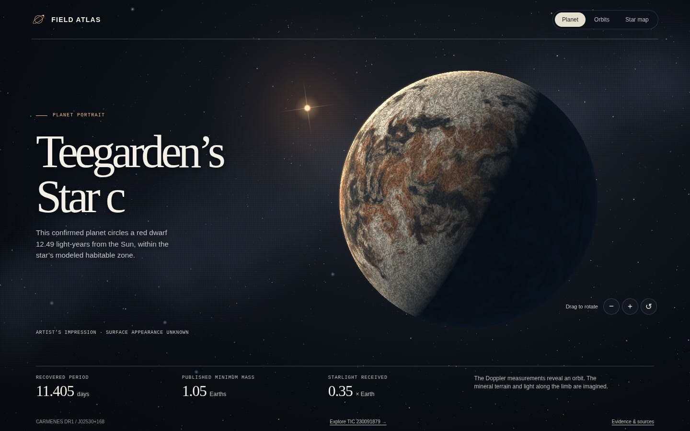

# RK-2 · Teegarden’s Star c

**Teegarden’s Star c is a confirmed planet with a temperate orbit.** It is 12.49 light-years away in the direction of Aries. A blind search of stellar velocities recovered its signal before the catalog comparison. The original discovery was published in 2019 and a four-instrument study confirmed it in 2024. The name RK-2 identifies this investigation. [NASA Exoplanet Archive](https://exoplanetarchive.ipac.caltech.edu/overview/teegarden) · [Discovery paper](https://doi.org/10.1051/0004-6361/201935460) · [Multi-instrument confirmation](https://doi.org/10.1051/0004-6361/202348033)

[Open the offline 3D atlas](field-atlas/index.html) · [Doppler measurements and methods](carmenes-search/README.md) · [TESS investigation](tess-search/README.md)

## What the observations establish

| Property | Blind recovery | Published solution (2024) |
|---|---:|---:|
| Orbital period | 11.4047 days | 11.416 ± 0.003 days |
| Minimum mass | 1.09 Earth masses | 1.05 (+0.14/−0.13) Earth masses |
| Orbital distance | 0.0456 AU | 0.0455 (+0.0015/−0.0016) AU |
| Starlight received | 0.53 times Earth’s, from the screening estimate | 0.35 ± 0.02 times Earth’s |

The blind search used 233 CARMENES nights. We then tested the recovered 11.4047-day period in 103 instrument-nights from ESPRESSO, HPF and MAROON-X. Allowing the velocity amplitude and orbital phase to vary gave a semiamplitude of 1.20 m/s. Adding the signal to a model with the two other planets reduced χ² by 14.18 for two additional parameters. This is a targeted consistency check with a fixed period, per-run velocity offsets and a white-noise approximation. Adding eight later CARMENES nights gave 1.22 m/s. The published study modeled the system and stellar activity using a longer baseline. [Fixed-period tests](carmenes-search/results/teegarden-fixed-period-check.csv) · [Published solutions](carmenes-search/data/teegarden-c-archive.csv)

## Potential for life

The atlas uses the published stellar luminosity of 0.000722 Suns. At 0.0455 AU this gives 0.349 times Earth’s starlight. With the published stellar temperature of 3,034 K, a one-Earth-mass climate model places the conservative habitable zone between **0.0280 and 0.0556 AU**. The planet’s orbit falls inside it. The higher screening estimate used the survey’s stellar radius and temperature to infer luminosity. Both estimates give the same habitable-zone classification. [Host and planet parameters](carmenes-search/data/teegarden-c-archive.csv) · [Climate model](https://doi.org/10.1088/2041-8205/787/2/L29)

Liquid water on the surface would require suitable atmospheric pressure and temperature. The planet’s true mass depends on inclination, and its atmosphere, surface water and surface temperature remain unknown. The observations establish **potential habitability**. Whether it supports life is an open question.

## Why the first lead remains open

TIC 230091879 showed a 133-day dimming, including two events outside the original pipeline fit. We also checked spatially resolved ground-based observations of the target and three nearby Gaia sources. A single usable ZTF exposure coincided with a predicted dip. None of the neighbors showed substantial dimming in that exposure. The target measurement was too noisy to resolve the TESS depth, and the TESS pixel images did not identify which star dimmed. The atlas keeps this field as a secondary, hypothetical scene. [TESS evidence and competing explanations](tess-search/README.md) · [Resolved measurements](tess-search/results/lead-ztf-in-window.csv)

Download and open the atlas HTML in a browser. Drag to rotate or use the arrow keys. The orbit view shows the three cataloged planets and the model habitable zone. The star map places the system relative to the Sun. The planet portrait is an artist’s impression.
