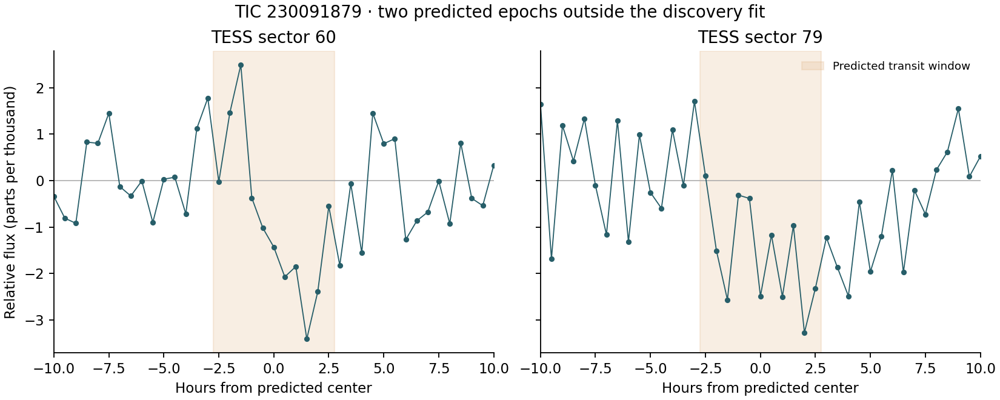

# Two additional dimmings at TIC 230091879

**Seven distinct epochs** show dimming near a 133.097-day timing prediction toward TIC 230091879 in Draco, about 314 light-years away. The public TESS pipeline flagged the periodic signal in March 2025. This reanalysis identifies two additional dimmings in full-frame photometry during gaps in that fit. A planet, an eclipsing stellar companion and an unresolved background source remain possible. [Original NASA validation summary](https://mast.stsci.edu/api/v0.1/Download/file?uri=mast:TESS/product/tess2019199201929-s0014-s0086-0000000230091879-01-00971_dvs.pdf) · [Target at ExoFOP](https://exofop.ipac.caltech.edu/tess/target.php?id=230091879)

## What repeated

We took the period and epoch from the original report and held them fixed. The predictions are `BJD_TDB − 2457000 = 1747.0873 + 133.09719 × cycle`. The original Data Validation time series contains zero finite initial-flux cadences inside the predicted 5.50-hour events at cycles 9 and 13. The following depths use MIT Quick-Look Pipeline (QLP) full-frame light curves, a local linear baseline and a fixed measurement window. [Coverage audit](results/lead-coverage.csv) · [Original time series](https://mast.stsci.edu/api/v0.1/Download/file?uri=mast:TESS/product/tess2019199201929-s0014-s0086-0000000230091879-00971_dvt.fits)

| TESS sector | Cycle | Predicted time in BTJD | QLP depth | Raw aperture depth | Local noise |
|---|---:|---:|---:|---:|---:|
| 60 | 9 | 2944.96201 | 984 ppm | 1,054 ppm | 450 ppm |
| 79 | 13 | 3477.35077 | 1,575 ppm | 1,520 ppm | 546 ppm |

The combined QLP depth is **1,223 ppm** with characteristic noise **347 ppm**, compared with the original fit of **1,420 ± 176 ppm**. The two extra epochs are individually weak. Three of 8,816 pairs of off-event windows gave an equal or larger combined dip. The windows overlap, and this target was selected from many signals, so this rank describes these light curves only. A second reduction, TESS-SPOC, gives positive depths at both epochs. It uses the same exposures. [Measurements](results/lead-extra-epochs.csv) · [All extractions](results/event-photometry.csv) · [QLP](https://archive.stsci.edu/hlsp/qlp) · [TESS-SPOC](https://archive.stsci.edu/hlsp/tess-spoc)



## Why the origin remains open

- The original report lists six pipeline events. Five have enough good two-minute data and local baseline for our measurement, all with positive depth. Sectors 60 and 79 bring the number of distinct well-covered dimmings in our check to seven. Multiple reductions of one epoch count once.
- The original report gives an odd/even depth difference of 1.15 standard deviations and a possible secondary dip of 617 ± 194 ppm, 35.778 days after the primary. We tested that exact offset with six QLP epochs and the primary duration. The mean depth was 12 ppm with characteristic noise of 229 ppm. These reductions use some of the same observations. Different eclipse shapes or durations could change the result. [Secondary-epoch measurements](results/lead-secondary.csv)
- The pipeline difference-image position is consistent with the target, but **zero of five difference images passed its quality criterion**. Our two additional 11 × 11 pixel cutouts also fail to isolate a common source. In sector 60 even the strongest pixel has a contrast of only 1.8 times its local scatter. In sector 79 the largest contrast is away from the target. Three much fainter Gaia sources lie 42–44 arcseconds from the target. An eclipsing neighbor could contribute light to a TESS aperture. Gaia classifies the target’s variability as SOLAR_LIKE. [Two new difference images](results/lead-pixels.png) · [Gaia field](results/lead-gaia-field.csv) · [Gaia variability classification](https://vizier.cfa.harvard.edu/viz-bin/VizieR-5?-source=I/358/vclassre&Source=1649494288953515136)
- The host search checked ExoFOP TOI and CTOI lists, the NASA confirmed-planet table, and the Villanova TESS eclipsing-binary catalog. Absence from a catalog cannot establish priority. The November 2026 positional checks returned zero TOI, CTOI or confirmed-planet hosts within two arcminutes. The initial signal and its ephemeris are public mission products. The contribution here is the extra-epoch photometry and its coverage audit. [MAST TCE tables](https://archive.stsci.edu/tess/bulk_downloads/bulk_downloads_tce.html) · [Villanova lookup](https://tessebs.villanova.edu/230091879)

## Potential for life

If the dips come from a planet transiting the target star, the pipeline fit implies **0.421 ± 0.009 AU**, **0.36 ± 0.06 times Earth’s irradiation** and a radius of **2.15 ± 1.66 Earth radii**. The last uncertainty is too large to distinguish rock from a thick gas envelope. At the catalog stellar temperature of 3,845 K and luminosity of 0.064 Suns, the one-Earth-mass conservative climate model spans roughly 0.26–0.50 AU. Surface water would depend on an atmosphere and a suitable surface. Neither has been measured. Spatially resolved photometry during a predicted dip would help identify which star dims. [NASA fit](https://mast.stsci.edu/api/v0.1/Download/file?uri=mast:TESS/product/tess2019199201929-s0014-s0086-0000000230091879-01-00971_dvs.pdf) · [Host parameters](results/lead-star.json) · [Kopparapu et al.](https://doi.org/10.1088/2041-8205/787/2/L29)

## Search and reproduction

The screen used 31 public single- and multi-sector TCE releases ending in sectors 81–108. These include earlier observations when they belong to a multi-sector search. Of 84,762 pipeline event rows, 407 met the initial broad irradiation, radius, transit count, impact parameter and signal criteria. After removing hosts already listed in the two ExoFOP lists or the NASA table and applying the stronger quality and centroid cuts in the script, 22 events on 21 stars remained. We tested all 22 timing predictions in SPOC two-minute photometry and five targets in full-frame products. The archive and catalog queries were run in November 2026. Live catalogs can change. [Initial screen](results/flux-radius-screen.csv) · [Frozen shortlist](results/unmatched-shortlist.csv)

For example, TIC 129781877 produced two measurable dips in the release that flagged it. Six usable predicted epochs outside that release averaged a brightening. The 133-day target retained dimmings across multiple sectors in both raw aperture flux and corrected flux. The calculations use a minimum local coverage threshold, a straight-line fit to the flanking data and the scatter of similarly sized windows elsewhere in the sector. The plotted half-hour bins are for display only.

Install the repository’s analysis dependencies and run these commands from the repository root. The cache stores FITS downloads locally. The fixed shortlist can be used directly for photometry.

```sh
python -m pip install -r requirements.txt
python tess-search/search.py
python tess-search/photometry.py --cache /tmp/tess-light-curves
python tess-search/followup.py --cache /tmp/tess-light-curves
python tess-search/secondary.py --cache /tmp/tess-light-curves
python tess-search/field.py
python tess-search/pixels.py --cache /tmp/tess-light-curves
```

This work uses public NASA TESS data from MAST, SPOC data validation products, MIT QLP and TESS-SPOC high-level science products, ExoFOP, the NASA Exoplanet Archive and ESA Gaia DR3 through CDS VizieR. The search, analysis and atlas were developed with OpenAI Codex.
